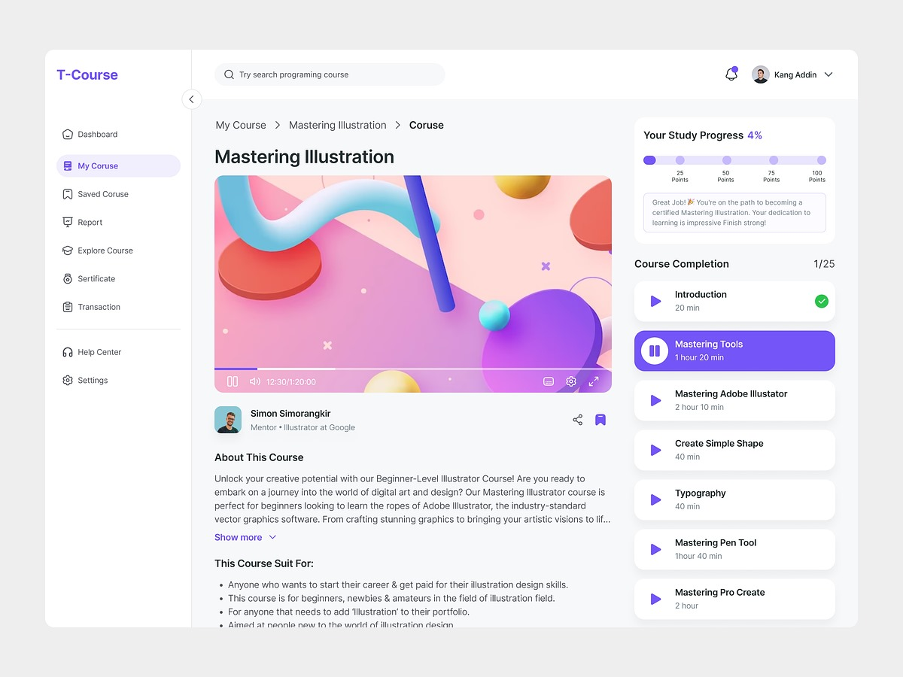

# LMS System

This is a Learning Management System (LMS) built with Next.js and Node.js. It allows users to create courses, enroll in courses, and take quizzes. The system also includes user authentication and authorization.

### Features

- User authentication
- Layout with sidebar and navbar and dynamic content banner
- Course creation and enrollment
- Video Transcoding
- Interactive quizzes
- Dashboard with analytics
- Orders and payments
- Notifications
- Admin Dashboard



## Installation

```bash
cd frontend
npm install
```

```bash
cd backend
npm install
```

## Getting Started

First, run the development server:

```bash
cd frontend
npm run dev
# or
yarn dev
```

```bash
cd backend
npm run start
```

Open http://localhost:3000 with your browser to see the result.

## Features

- User authentication
- Course creation and enrollment
- Interactive quizzes
- And more...

## Technologies Used

- Frontend: Next.js
- Backend: Node.js
- Database: PostgreSQL

## Contributing

Pull requests are welcome. For major changes, please open an issue first to discuss what you would like to change.
